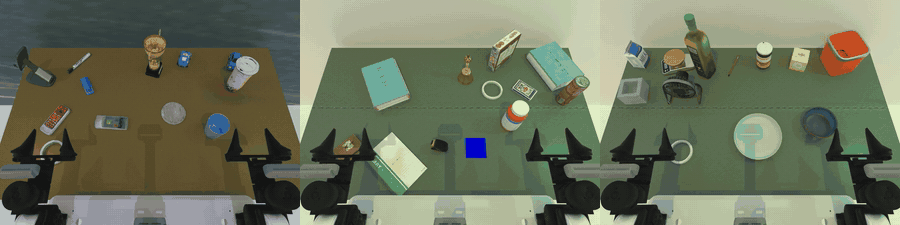

<div align="center">

# nanoAstra

### A Glimpse of Training VLMs as Foundation Models for Robotic Manipulation

[](https://arxiv.org/abs/2611.29338)
[](https://arxiv.org/pdf/2611.29338)
[](https://nanoastra.github.io)
[](https://huggingface.co/Hugo-AGI/nanoAstra)

Meng-Hao Guo<sup>1,\*,†</sup>, Yi Zhang<sup>1,\*</sup>, Zhe-Han Mo<sup>1,\*</sup>, Han-Zheng Wang<sup>1,\*</sup>, Jia-Jun Wang<sup>1,\*</sup>,
Xin-Sheng Chen<sup>1,\*</sup>, Jiaxi Song<sup>1</sup>, Yi-Xuan Deng<sup>1</sup>, Jia-Ning Li<sup>1</sup>, Xuanyu Chu<sup>1</sup>,
Hengrui Zhang<sup>1</sup>, Huan-ang Gao<sup>1</sup>, Yongming Rao<sup>2</sup>, Shi-Min Hu<sup>1,✉</sup>

<sup>1</sup>Tsinghua University &nbsp;&nbsp; <sup>2</sup>Tencent Hunyuan

<sup>\*</sup>Core Contributors &nbsp;&nbsp; <sup>†</sup>Project Lead &nbsp;&nbsp; <sup>✉</sup>Corresponding Author

</div>

<p align="center">
  
</p>

## Overview

**nanoAstra** trains a vision-language model (VLM) for generalizable robot manipulation through its native text interface, with no separate action head. At each decision point, the model writes the task **progress** and the next **semantic steps**, built from reusable, parameterized action primitives such as `move x +5.0` or `gripper open`.

- **Semantic action modeling.** More than 5,000 hours of heterogeneous robot demonstrations are filtered, geometrically standardized, and segmented at behavioral decision points into semantic steps with dense progress descriptions.
- **Capability-preserving SFT (CP-SFT).** A robot-specific system prompt softly confines manipulation outputs to a structured response space. Co-training with general VQA data helps keep the model's broader vision-language capabilities.
- **Zero-shot manipulation.** On RoboTwin 2.0's randomized benchmark, nanoAstra-9B reaches a **17.8%** zero-shot success rate, ahead of the evaluated VLA, WAM, and VLM baselines.
- **Streaming execution.** On a single H20 GPU, inference is faster than the motion it produces. Overlapping the two reduces the robot's idle time from **35.0%** to **6.9%**.

<p align="center">
  
</p>

## News

- **2026-11** — Code and [nanoAstra-9B](https://huggingface.co/Hugo-AGI/nanoAstra) weights released.
- **2026-11** — Paper released on [arXiv](https://arxiv.org/abs/2611.29338).

## Installation

```bash
git clone --recurse-submodules https://github.com/Hugo-AGI/nanoAstra.git
cd nanoAstra
```

1. **Simulator.** Install the pinned `RoboTwin/` submodule following its README, including its assets. Then, in
   that environment:

   ```bash
   pip install -r requirements.txt
   ```

2. **Model.** In a separate environment, install [vLLM](https://github.com/vllm-project/vllm) and start the server,
   which downloads the weights on first use:

   ```bash
   pip install vllm==0.27.1
   bash scripts/serve.sh Hugo-AGI/nanoAstra        # http://127.0.0.1:8000/v1
   ```

## Quick start

```bash
python scripts/eval_robotwin.py --task place_empty_cup --output results/streaming/place_empty_cup
```

This runs 10 episodes of one task with streaming execution. Each episode directory holds the images sent to the
model, `trace.json` with every prompt, reply and step outcome, and a video. Rerunning the command skips finished
episodes. Use `--api_base` for a server on another machine.

`--mode` selects how replies are executed:

| `--mode` | Simulator during inference | Robot |
| --- | --- | --- |
| `streaming` (default) | keeps running | starts each step as soon as it is written |
| `blocking` | keeps running | waits for the whole reply |
| `paused` | waits for the model | executes the whole reply |

## Reproducing the paper results

```bash
for seeds in nanoastra/robotwin/seeds/*.json; do
    task=$(basename "$seeds" .json)
    python scripts/eval_robotwin.py --task "$task" --mode paused --output "results/paused/$task"
done
python scripts/summarize.py results/paused
```

For blocking and streaming, change `--mode` and the output directory, and add `--episodes 5`.

| `--mode` | Runs per task | Success rate |
| --- | --- | --- |
| `paused` | 10 | 17.8% |
| `blocking` | 5 | 11.2% |
| `streaming` | 5 | 12.9% |

Every run uses the same fixed seeds per task. In blocking and streaming modes, the simulator keeps running during
inference and success counts within RoboTwin's official time limit; replies take as long as they would at H20
latency, so these results do not depend on your hardware. Results vary between runs. Several evaluation processes can
share one GPU and one server: split the work with `--task`, `--start_episode` and `--episodes`.

## Citation

If you find this work useful, please cite:

```bibtex
@article{guo2026glimpse,
  title   = {A Glimpse of Training VLMs as Foundation Models for Robotic Manipulation},
  author  = {Guo, Meng-Hao and Zhang, Yi and Mo, Zhe-Han and Wang, Han-Zheng and
             Wang, Jia-Jun and Chen, Xin-Sheng and Song, Jiaxi and Deng, Yi-Xuan and
             Li, Jia-Ning and Chu, Xuanyu and Zhang, Hengrui and Gao, Huan-ang and
             Rao, Yongming and Hu, Shi-Min},
  journal = {arXiv preprint arXiv:2611.29338},
  year    = {2026}
}
```

## Acknowledgements

nanoAstra-9B is initialized from [Qwen3.5-9B](https://huggingface.co/Qwen/Qwen3.5-9B). The evaluation runs on
[RoboTwin 2.0](https://github.com/RoboTwin-Platform/RoboTwin).

## License

The code is released under the [MIT license](LICENSE); the weights follow the license on their
[model card](https://huggingface.co/Hugo-AGI/nanoAstra).
